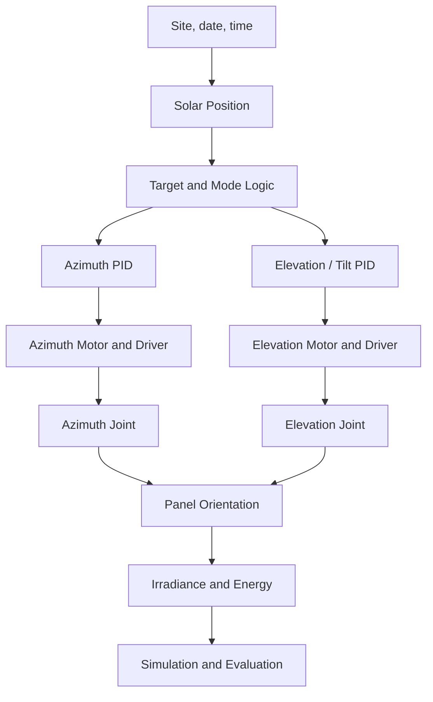

# ☀️ Solar Tracker Control Simulation

### Solar Tracking System Modeling and Control Simulation

[](https://github.com/JhonsJSSimatupang/Solar-Tracker-Control-Simulation)
[](https://www.mathworks.com/academia/student-challenge/mathworks-excellence-in-innovation-signup.html?tfa_1=Solar+Tracker+Control+Simulation&tfa_2=249)
[](https://www.mathworks.com/products/matlab.html)
[](https://www.mathworks.com/products/simulink.html)
[](LICENSE)

---

## 📌 Overview

Solar energy systems are widely used as a renewable energy source. However, the amount of solar energy captured by a photovoltaic (PV) panel depends partly on its orientation relative to the sun.

A solar tracking system is designed to adjust the panel's orientation to follow the apparent movement of the sun, with the aim of improving solar energy collection.

This project focuses on the study, design, and simulation of a **dual-axis azimuth–elevation solar tracking control system** using MATLAB and Simulink. The development process covers system modeling, control strategy development, simulation, and performance evaluation. The baseline configuration rotates the panel about a vertical azimuth axis and a horizontal elevation (tilt) axis; a single-axis azimuth case is retained for comparison and as a candidate degraded mode.

The project is developed as a Capstone Project, with this repository serving as the central workspace for source code, simulation models, supporting data, results, and technical documentation.

> **Project Focus:** Solar tracking systems, control system modeling, MATLAB/Simulink simulation, and performance evaluation.

---

## 🎯 Objectives

- Study the fundamental principles of solar tracking systems.
- Understand the relationship between solar position and photovoltaic panel orientation.
- Define the system requirements for a dual-axis azimuth–elevation tracker.
- Develop mathematical and simulation models using MATLAB and Simulink.
- Design and implement the azimuth and elevation controllers.
- Compare fixed, single-axis, and dual-axis energy performance.
- Evaluate system behavior under selected operating conditions.
- Analyze simulation results and identify potential improvements.

---

## 🧠 System Concept

The project explores a solar tracking system through a modeling and simulation workflow.

The dual-axis workflow selected at Gate G1 is illustrated below:



The diagram shows the architecture selected at Gate G1. The detailed requirements and interfaces are documented in [System Design](docs/SYSTEM_DESIGN.md). The Simulink/Simscape implementation follows the diagram: a reduced-order model for the 24 h energy study and a 10 ms Simscape plant model for control and actuator validation.

---

## 🛠️ Technologies

| Technology | Purpose |
|---|---|
| MATLAB | Mathematical modeling, computation, and data analysis |
| Simulink | System modeling and dynamic simulation |
| Simscape | Lumped-parameter rotational mechanics of both axes |
| Simscape Electrical | DC motor and driver model |
| MATLAB Unit Test Framework | Automated unit, integration, and regression tests |
| Git / GitHub | Version control and repository documentation |

MATLAB, Simulink, Simscape, and Simscape Electrical are required and installed.
Control System Toolbox is installed but the project does not depend on it: the
controllers are implemented as explicit Simulink blocks. Simulink Control
Design, Stateflow, Simulink Test, and Simscape Multibody are optional and not
installed; see
[Environment Setup](docs/SETUP.md).

---

## 📂 Repository Structure

```text
Solar-Tracker-Control-Simulation/
│
├── README.md
├── LICENSE
├── .gitignore
├── run_project.m
├── run_steps.m
│
├── models/
│   ├── build_solar_tracker_model.m
│   ├── build_axis_plant.m
│   ├── verify_axis_plant.m
│   ├── build_tracker_plant_model.m
│   ├── validate_tracker_plant.m
│   ├── solar_tracker.slx
│   └── solar_tracker_plant.slx
│
├── src/
│   ├── initialization/
│   │   ├── configure_sdi_preferences.m
│   │   ├── project_config.m
│   │   └── setup_project.m
│   ├── sun_position/
│   │   ├── solar_position.m
│   │   ├── solar_vector.m
│   │   ├── panel_normal.m
│   │   ├── angle_of_incidence.m
│   │   └── target_angles.m
│   ├── energy/
│   │   ├── clear_sky_irradiance.m
│   │   ├── plane_of_array_irradiance.m
│   │   ├── energy_metrics.m
│   │   ├── daily_energy_simulation.m
│   │   └── compare_daily_energy.m
│   ├── controllers/
│   │   └── tracker_mode_logic.m
│   └── analysis/
│       ├── compare_tracker_axes.m
│       └── design_sizing.m
│
├── results/
│   ├── figures/
│   │   ├── axis_comparison.png
│   │   ├── daily_energy_comparison.png
│   │   ├── plant_validation.png
│   │   └── tracking_response.png
│   └── metrics/
│       ├── axis_comparison.csv
│       ├── daily_energy_comparison.csv
│       ├── plant_validation.csv
│       └── tracking_metrics.csv
│
├── docs/
│   ├── PROJECT_PLAN.md
│   ├── REQUIREMENTS_CHECKLIST.md
│   ├── CAPSTONE_REPORT.md
│   ├── DEVELOPMENT_LOG.md
│   ├── SETUP.md
│   ├── WORKFLOW.md
│   ├── TEST_PLAN.md
│   ├── AI_USAGE_LOG.md
│   ├── SYSTEM_DESIGN.md
│   ├── REFERENCES.md
│   ├── design/
│   │   └── G2_DESIGN_CALCULATIONS.md
│   └── references/
│       └── MILESTONE_1_PROJECT_RESEARCH.md
│
└── tests/
    ├── unit/
    │   ├── test_solar_position.m
    │   ├── test_target_angles.m
    │   ├── test_axis_comparison.m
    │   ├── test_design_sizing.m
    │   ├── test_energy_model.m
    │   └── test_mode_logic.m
    ├── check_environment.m
    ├── run_unit_tests.m
    ├── run_all_tests.m
    └── run_everything.m
```

| Path             | Description                                                         |
| ---------------- | ------------------------------------------------------------------- |
| `run_project.m`  | Single entry point: trajectory, simulation, metrics, and figure     |
| `run_steps.m`    | The same project as twelve runnable sections, notebook style        |
| `models/`        | Simulink model and its reproducible build script                    |
| `src/`           | MATLAB source: initialization, sun position, energy, control, analysis |
| `results/`       | Simulation figures and quantitative metrics                         |
| `docs/`          | Project planning, design, references, and development records       |
| `tests/`         | Automated tests and verification scripts                            |

---

## 🚀 Getting Started

### Prerequisites

| Product | Required | Notes |
|---|---|---|
| MATLAB | Yes | R2026a Update 5 or R2026b Update 1 |
| Simulink | Yes | comes with MATLAB |
| Simscape | Yes | axis plant |
| Simscape Electrical | Yes | DC motor electrical domain |
| Control System Toolbox | No | installed on the reference machine, not used |
| Simscape Multibody | No | deliberately not used; lumped-parameter rotational dynamics |
| Simulink Control Design | No | tuning is done in scripts |
| Stateflow | No | supervisory logic is a MATLAB function |
| Simulink Test | No | tests are MATLAB scripts |
| Simulink Coverage | No | not used |

`tests/check_environment.m` reports which of these are actually present. The
last five products are optional: every entry point runs without them. Details
and the Gate G0 checklist are in [Environment Setup](docs/SETUP.md).

### Installation

Clone the repository:

```bash
git clone https://github.com/JhonsJSSimatupang/Solar-Tracker-Control-Simulation.git
```

Navigate to the project directory:

```bash
cd Solar-Tracker-Control-Simulation
```

Open the project directory in MATLAB or Visual Studio Code.

Run the main entry point from MATLAB:

```matlab
run_project
```

The entry point adds the source folders to the MATLAB path, loads the project
parameters from `src/initialization/setup_project.m`, builds the solar target
trajectory for the configured day, runs the model in `models/solar_tracker.slx`,
and writes `results/metrics/tracking_metrics.csv` and
`results/figures/tracking_response.png`. Pass `'ShowPlots', false` to suppress
the figure window or `'StopTime', 3600` for a one-hour run.

To run the project as runnable sections, notebook style:

```matlab
edit run_steps.m
```

`run_steps.m` is one file split into twelve `%%` sections. Put the cursor in a
section and press **Ctrl+Enter** (Run Section) to run only that part, the way a
Colab cell works. Section 1 sets the folder and path and has to be run once per
MATLAB session; after that any section can be run on its own. **Run** (F5)
executes all twelve in order. The sections follow the same order as
`tests/run_everything.m`: environment, configuration, model build, plant
verification, plant validation, 24 h simulation, daily and annual energy,
actuator sizing, unit tests, and the full suite.

To run the unit tests:

```matlab
addpath('tests');
results = run_unit_tests();
assertSuccess(results);
```

The current suite has 50 tests covering the solar position, target angles, axis
comparison, actuator sizing, energy model, and mode logic.

To run every test level and print one summary table:

```matlab
addpath(genpath('tests'));
summary = run_all_tests();
```

The runner checks the environment, the 50 unit tests, the Simscape axis plant,
the closed-loop plant validation, the end-to-end integration run (including a
regression check against the stored metrics and a repeat run for
reproducibility), and the actuator margins. It writes
`results/test-reports/test_summary.csv` and throws
`run_all_tests:Failed` if any stage fails, so it also works as a single gate in
CI:

```bash
matlab -batch "addpath(genpath('tests')); run_all_tests"
```

A stage that cannot run on the current installation is reported as skipped
rather than failed. Set `'IncludeAnalysis', true` to add the annual axis
comparison, which takes several minutes.

To regenerate the annual axis comparison:

```matlab
addpath(genpath('src'));
results = compare_tracker_axes('WriteFiles', true);
```

To regenerate the daily energy comparison:

```matlab
addpath(genpath('src'));
[results, details] = compare_daily_energy('WriteFiles', true);
```

---

## 🧪 Simulation and Testing

The project will investigate system behavior through simulation under selected operating conditions.

Initial testing areas may include:

| Test area | Description | Status |
|---|---|---|
| Solar position | Azimuth and elevation against NREL SPA and physical invariants | Unit tests passing (10/10) |
| Target angles | Azimuth and panel-tilt commands, clamping, and night stow | Unit tests passing (5/5) |
| Axis comparison | Annual fixed, single-axis, and dual-axis energy proxy | Completed; CSV and PNG generated |
| Actuator sizing | Torque, current, voltage, and speed margins for both axes | Unit tests passing (5/5) |
| Energy model | Clear-sky irradiance, plane-of-array, and daily energy integration | Unit tests passing (10/10) |
| Mode logic | Day track, deadband hold, night stow, cloud hold, and fault safe state | Unit tests passing (15/15) |
| Baseline operation | End-to-end run of the baseline two-axis model | Baseline model runs; metrics and figure generated |
| Tracking response | Evaluate the azimuth and elevation control loops | Baseline response generated; plant validation 14/14 pass |
| Control performance | Analyze the selected control approach | Step and tracking metrics on the Simscape plant |
| System performance | Evaluate the overall simulation performance | End-to-end run and full test suite pass |
| Fault handling | Detect a motor or sensor fault and enter a safe state | Planned (advanced) |
| Full test run | One command runs environment, unit, plant, integration, and sizing stages | `tests/run_all_tests.m` runs and writes `results/test-reports/test_summary.csv` |
| Run everything | Every executable file, in dependency order, from one command | `tests/run_everything.m`; 16 steps, one pass/fail line per step |
| Runnable sections | The same run as twelve notebook-style cells | `run_steps.m`; Ctrl+Enter per section |

The numerical test cases and pass criteria are documented in
[Test Plan](docs/TEST_PLAN.md).

---

## 📊 Simulation Results

### Current results — axis screening

The annual direct-beam proxy for Malang 2026 is available. It uses the
NOAA/Meeus solar position and a Meinel clear-sky direct-beam model. It excludes
diffuse irradiance and actuator energy, so the absolute values are screening
estimates, not the final energy result.

| Configuration | Energy (kWh/m²/year) | Gain vs fixed |
|---|---:|---:|
| Fixed, optimal tilt 8° | 2276.6 | — |
| Single-axis azimuth, optimal tilt 43° | 3062.2 | +34.5% |
| Horizontal north–south single-axis | 3115.4 | +36.8% |
| Dual-axis (ideal) | 3264.5 | +43.4% |

Generated files:

- [`results/metrics/axis_comparison.csv`](results/metrics/axis_comparison.csv)
- [`results/figures/axis_comparison.png`](results/figures/axis_comparison.png)

### Current results — daily energy model

The daily model adds diffuse and ground-reflected irradiance with the isotropic
sky model. It uses a 1.6 m² panel, 18% PV efficiency, and an 85% system loss
factor. Results for 2026-03-21 at 5-minute sampling:

| Configuration | Daily PV energy (kWh) | Actuator energy (kWh) | Net energy (kWh) | Gain vs fixed (PV / net) |
|---|---:|---:|---:|---:|
| Fixed, tilt 8° | 1.836 | 0 | 1.836 | — / — |
| Single-axis azimuth, tilt 43° | 2.299 | 0.009 | 2.289 | +25.2% / +24.7% |
| Dual-axis | 2.449 | 0.036 | 2.413 | +33.4% / +31.4% |

The actuator energy is estimated from the DC-motor and gear parameters with
`src/energy/tracker_actuator_energy.m`: a quasi-static torque balance at each
sample, with friction, the tilt-dependent gravity torque, and a 2 N·m wind
torque. It assumes a non-self-locking worm gear, so the elevation motor holds
the panel against gravity all night; that is the conservative case and it shows
up as the 36 Wh/day dual-axis figure.

Seasonal check: the dual-axis **net** gain is +37.9% on 2026-06-21 and +44.9%
on 2026-12-21 (PV-only gains are +40.1% and +47.0%). The daily gain is lower
than the annual direct-beam proxy because the daily model includes the diffuse
component and a ground-reflected term.

Generated files:

- [`results/metrics/daily_energy_comparison.csv`](results/metrics/daily_energy_comparison.csv)
- [`results/figures/daily_energy_comparison.png`](results/figures/daily_energy_comparison.png)

### Current results — preliminary actuator sizing

The Gate G2 static sizing selects 100:1 and 150:1 worm gears and verifies the
preliminary 24 V DC motors. The full calculation is in
[G2 Design Calculations](docs/design/G2_DESIGN_CALCULATIONS.md).

| Quantity | Azimuth | Elevation |
|---|---:|---:|
| Required output torque | 11.40 N·m | 17.06 N·m |
| Motor torque | 0.163 N·m | 0.162 N·m |
| Motor current | 3.26 A | 3.25 A |
| Current limit | 5.0 A | 5.0 A |
| Torque margin | 1.54 | 1.54 |
| Speed margin | 137.5 | 91.7 |

The elevation axis needs about 1.12 A to hold the panel at tilt 0°; a
self-locking gear or a holding brake can avoid this holding energy at night.

### Current results — baseline tracking model

`run_project` now builds the daily solar trajectory, runs the baseline two-axis
model, and writes the tracking metrics and response figure. The baseline model
uses standard Simulink blocks (PI controllers plus simplified axis plants), so
these values verify the trajectory and metric pipeline, not the final Simscape
mechanics.

Full-day run for 2026-03-21:

| Metric | Azimuth | Tilt |
|---|---:|---:|
| RMS tracking error | 0.187° | 0.078° |
| Maximum absolute error | 3.94° | 1.32° |

The largest errors occur at the sunrise and sunset transitions, where the
target moves between the stow position and the daytime trajectory.

Generated files:

- [`results/metrics/tracking_metrics.csv`](results/metrics/tracking_metrics.csv)
- [`results/figures/tracking_response.png`](results/figures/tracking_response.png)

### Current results — explicit motor and axis plant

Each axis is now modelled from first principles in
`models/build_axis_plant.m` (Simscape Electrical + Mechanical), so the motor
equations are visible instead of hidden inside a library block:

```
V = Ra*i + La*di/dt + Ke*omega
J_eq*domega/dt = Kt*i - T_friction - T_dist/(eta*N)
J_eq = J_load/N^2 + J_motor
```

`models/verify_axis_plant.m` compares the response with closed-form results:

| Check | Reference | Simulated |
|---|---:|---:|
| No-load steady-state speed at 24 V | 458.015 rad/s | 457.955 rad/s |
| Armature current ceiling | 5 A | 5.000 A |
| Speed rise time | 0.371 s | 0.371 s |
| Bus voltage ceiling (30 V command, 24 V bus) | 24 V | 24.000 V |

All four checks pass. The current ceiling is enforced by clamping the applied
voltage to `Ke*omega ± Ra*currentLimit`, which is exactly equivalent to
`|i| <= i_limit` and avoids an algebraic loop; a `VbusLim` saturation block then
clamps the result to the supply rails.

### Current results — closed-loop plant validation

`models/solar_tracker_plant.slx` closes two full PID loops around the explicit
axis plants: filtered derivative on the measurement, integrator clamped to the
voltage limit, and a rate limiter. It runs at the configured 10 ms control step
with Simscape local solvers. `models/validate_tracker_plant.m` runs a step
scenario and a two-hour tracking window on the configured day.

| Scenario | Metric | Value | Criterion |
|---|---|---:|---|
| Step, azimuth | Overshoot | 8.07 % | ≤ 10 % |
| Step, azimuth | Settling time (2 %) | 7.43 s | ≤ 20 s |
| Step, azimuth | Steady-state error | 0.011° | ≤ 0.2° |
| Step, tilt | Overshoot | 6.84 % | ≤ 10 % |
| Step, tilt | Settling time (2 %) | 7.18 s | ≤ 20 s |
| Step, tilt | Steady-state error | 0.007° | ≤ 0.2° |
| Both axes | Peak armature current | 5.000 A | ≤ 5.1 A |
| Tracking | Azimuth RMSE | 0.0108° | ≤ 0.5° |
| Tracking | Tilt RMSE | 0.0099° | ≤ 0.5° |
| Tracking | Azimuth max error | 0.347° | ≤ 2.0° |
| Tracking | Tilt max error | 0.310° | ≤ 2.0° |

All 14 checks pass. The tracking window is two hours rather than a full day
because a 10 ms fixed step over 24 h needs 8.6 million steps; the daily energy
study therefore stays on the reduced-order model, whose absolute errors are
validated against the plant model over short horizons.

Generated files:

- [`results/metrics/plant_validation.csv`](results/metrics/plant_validation.csv)
- [`results/figures/plant_validation.png`](results/figures/plant_validation.png)

### Planned results

- PV panel orientation and angle of incidence.
- Azimuth and elevation controller step responses.
- Net energy including actuator consumption.
- Performance comparison under clear, cloudy, rainy, and night conditions.
- Fault detection and safe-state behavior.

Simulation figures, quantitative measurements, and performance conclusions will
be added after the corresponding experiments have been completed.

---

## 📚 Documentation

| Document                                   | Description                                             |
| ------------------------------------------ | ------------------------------------------------------- |
| [Project Plan](docs/PROJECT_PLAN.md)       | Objectives, scope, roadmap, and dated schedule          |
| [Requirements Checklist](docs/REQUIREMENTS_CHECKLIST.md) | Official requirements, project decisions, and unknowns |
| [Capstone Report](docs/CAPSTONE_REPORT.md) | Final report outline and writing checklist               |
| [Development Log](docs/DEVELOPMENT_LOG.md) | Chronological record of project activities and progress |
| [Environment Setup](docs/SETUP.md)         | MATLAB, toolbox, and development tool preparation       |
| [Workflow](docs/WORKFLOW.md)               | Execution phases, review gates, and AI usage protocol   |
| [Test Plan](docs/TEST_PLAN.md)             | Test levels, test cases, pass criteria, and traceability |
| [AI Usage Log](docs/AI_USAGE_LOG.md)       | Record of generative AI use and verification            |
| [System Design](docs/SYSTEM_DESIGN.md)     | System architecture and design decisions                |
| [References](docs/REFERENCES.md)           | Research papers and technical resources                 |
| [Project Research](docs/references/MILESTONE_1_PROJECT_RESEARCH.md) | Official brief, requirements, and unknowns |

Additional technical documentation will be maintained in the `docs/` directory as the project develops.

---

## 🤖 Generative AI Usage

This project uses generative AI as a **development assistant**, not as a
replacement for engineering judgement. The full record is in the
[AI Usage Log](docs/AI_USAGE_LOG.md).

### Tool and scope

| Item | Detail |
|---|---|
| Tool | OpenCode with the DeepSeek model |
| Used for | Code scaffolding, refactoring, debugging, documentation editing, and test suggestions |
| Not used for | Generating simulation results, fabricating data or references, or making design decisions |
| Logged sessions | AI-001 to AI-008 |

### How AI output is verified

Every non-trivial AI-assisted change goes through the same protocol:

1. Read the output line by line.
2. Explain it without the AI chat open.
3. Run it on at least two cases.
4. Change one parameter and predict the effect before running.
5. Record the verification in the AI Usage Log.
6. Commit only after the verification passes.

The automated evidence is reproducible:

```matlab
addpath('tests');
results = run_unit_tests();
assertSuccess(results);   % 50 tests
```

AI-assisted files also carry a header comment:

```matlab
% AI-assisted: <what the AI helped with>.
% Reviewed and tested by <name> on <YYYY-MM-DD>.
```

### Disclosure statement

> This project used generative AI tools for code scaffolding, refactoring,
> debugging assistance, documentation editing, and test-case suggestions. All
> AI-assisted output was reviewed, tested, and adapted by the author. The
> author understands and can reproduce every part of the submitted work. No
> simulation results, data, or citations were generated by AI.

---

## 🎓 Capstone Project

This repository is developed as part of the Solar Tracker Control Simulation Capstone Project.

The project is also associated with **MathWorks Excellence in Innovation**, under the following project registration:

| Information               | Details                          |
| ------------------------- | -------------------------------- |
| Project Title             | Solar Tracker Control Simulation |
| Project ID                | 249                              |
| Project Type              | Capstone Project                 |
| Main Development Platform | MATLAB and Simulink              |
| Current Stage             | Gate G3 — baseline Simulink model, trajectory, and tracking metrics complete |

Related program:

- [MathWorks Excellence in Innovation](https://www.mathworks.com/academia/student-challenge/mathworks-excellence-in-innovation-signup.html?tfa_1=Solar+Tracker+Control+Simulation&tfa_2=249)

---

## 👤 Project Author

**Jhons Janner Samuel S.**

Capstone Project Developer

---

## 📄 License

This project is distributed under the BSD 2-Clause License. See the [LICENSE](LICENSE) file for details.

---

<p align="center">
  <i>Building, modeling, and evaluating solar tracking systems through simulation.</i>
</p>

<p align="center">
  Developed as a Capstone Project using MATLAB and Simulink.
</p>
