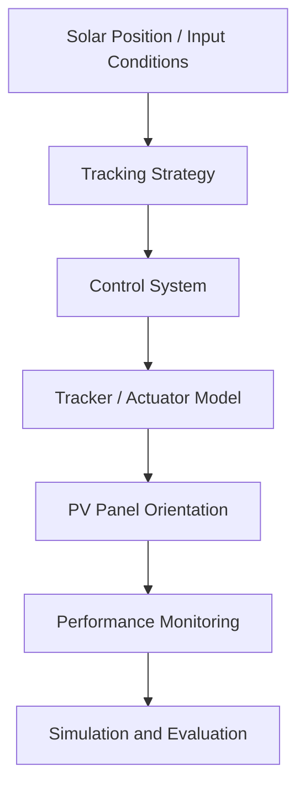

# ☀️ Solar Tracker Control Simulation

### Solar Tracking System Modeling and Control Simulation

[](https://github.com/JhonsJSSimatupang/Solar-Tracker-Control-Simulation)
[](https://www.mathworks.com/academia/student-challenge/mathworks-excellence-in-innovation-signup.html?tfa_1=Solar+Tracker+Control+Simulation&tfa_2=249)
[](https://www.mathworks.com/products/matlab.html)
[](https://www.mathworks.com/products/simulink.html)
[](LICENSE)

---

## 📌 Overview

Solar energy systems are widely used as a renewable energy source. However, the amount of solar energy captured by a photovoltaic (PV) panel depends partly on its orientation relative to the sun.

A solar tracking system is designed to adjust the panel's orientation to follow the apparent movement of the sun, with the aim of improving solar energy collection.

This project focuses on the study, design, and simulation of a solar tracking control system using MATLAB and Simulink. The development process will cover system modeling, control strategy development, simulation, and performance evaluation.

The project is developed as a Capstone Project, with this repository serving as the central workspace for source code, simulation models, supporting data, results, and technical documentation.

> **Project Focus:** Solar tracking systems, control system modeling, MATLAB/Simulink simulation, and performance evaluation.

---

## 🎯 Objectives

- Study the fundamental principles of solar tracking systems.
- Understand the relationship between solar position and photovoltaic panel orientation.
- Define the system requirements and proposed tracking approach.
- Develop mathematical and simulation models using MATLAB and Simulink.
- Design and implement an appropriate control strategy.
- Evaluate system behavior under selected operating conditions.
- Analyze simulation results and identify potential improvements.

---

## 🧠 System Concept

The project explores a solar tracking system through a modeling and simulation workflow.

The initial conceptual workflow is illustrated below:



The diagram represents an initial conceptual workflow. The actual system architecture, tracking mechanism, control method, and model components will be determined during the system design stage.

The final system concept will be updated according to the implemented design.

---

## 🛠️ Technologies

| Technology | Purpose                                               |
| ---------- | ----------------------------------------------------- |
| MATLAB     | Mathematical modeling, computation, and data analysis |
| Simulink   | System modeling and dynamic simulation                |
| Git        | Version control                                       |
| GitHub     | Repository management and project documentation       |

Additional MATLAB toolboxes and supporting technologies will be identified according to the system requirements.

---

## 📂 Repository Structure

```text
Solar-Tracker-Control-Simulation/
│
├── README.md
├── LICENSE
├── .gitignore
│
├── docs/
│   ├── PROJECT_PLAN.md
│   ├── DEVELOPMENT_LOG.md
│   ├── SYSTEM_DESIGN.md
│   └── REFERENCES.md
│
├── src/
├── simulink/
├── data/
└── results/
```

| Directory   | Description                                                        |
| ----------- | ------------------------------------------------------------------ |
| `docs/`     | Project planning, technical documentation, and development records |
| `src/`      | MATLAB source code and computational scripts                       |
| `simulink/` | Simulink models and related files                                  |
| `data/`     | Input data and supporting datasets                                 |
| `results/`  | Simulation outputs, figures, and evaluation results                |

---

## 🚀 Getting Started

### Prerequisites

The following tools are expected to be used during development:

- MATLAB
- Simulink
- Git
- GitHub account

Exact MATLAB versions, required toolboxes, and additional dependencies will be documented after the development environment is finalized.

### Installation

Clone the repository:

```bash
git clone https://github.com/JhonsJSSimatupang/Solar-Tracker-Control-Simulation.git
```

Navigate to the project directory:

```bash
cd Solar-Tracker-Control-Simulation
```

Open the project directory in MATLAB or Visual Studio Code.

The main execution entry point and simulation instructions will be documented after the system implementation is established.

---

## 🧪 Simulation and Testing

The project will investigate system behavior through simulation under selected operating conditions.

Initial testing areas may include:

| Test Scenario            | Description                                              | Status  |
| ------------------------ | -------------------------------------------------------- | ------- |
| Baseline Operation       | Observe the initial system behavior                      | Planned |
| Solar Position Variation | Examine tracking behavior under changing solar positions | Planned |
| Tracking Response        | Evaluate the response of the tracking control system     | Planned |
| Control Performance      | Analyze the behavior of the selected control approach    | Planned |
| System Performance       | Evaluate the overall simulation performance              | Planned |

The final test scenarios will be refined according to the approved system design and project requirements.

---

## 📊 Simulation Results

This section will present the actual simulation findings after implementation and validation.

Potential results to be documented include:

- Solar tracking response.
- PV panel orientation.
- System response characteristics.
- Simulation graphs and waveforms.
- Performance comparison under selected operating conditions.
- Analysis of system behavior and limitations.

Simulation figures, quantitative measurements, and performance conclusions will be added after the corresponding experiments have been completed.

---

## 📚 Documentation

| Document                                   | Description                                             |
| ------------------------------------------ | ------------------------------------------------------- |
| [Project Plan](docs/PROJECT_PLAN.md)       | Project objectives, scope, and development roadmap      |
| [Development Log](docs/DEVELOPMENT_LOG.md) | Chronological record of project activities and progress |
| [System Design](docs/SYSTEM_DESIGN.md)     | System architecture and design decisions                |
| [References](docs/REFERENCES.md)           | Research papers and technical resources                 |

Additional technical documentation will be maintained in the `docs/` directory as the project develops.

---

## 🎓 Capstone Project

This repository is developed as part of the Solar Tracker Control Simulation Capstone Project.

The project is also associated with **MathWorks Excellence in Innovation**, under the following project registration:

| Information               | Details                          |
| ------------------------- | -------------------------------- |
| Project Title             | Solar Tracker Control Simulation |
| Project ID                | 249                              |
| Project Type              | Capstone Project                 |
| Main Development Platform | MATLAB and Simulink              |

Related program:

- [MathWorks Excellence in Innovation](https://www.mathworks.com/academia/student-challenge/mathworks-excellence-in-innovation-signup.html?tfa_1=Solar+Tracker+Control+Simulation&tfa_2=249)

---

## 👤 Project Author

**Jhons Janner Samuel S.**

Capstone Project Developer

---

## 📄 License

This project is distributed under the BSD 2-Clause License. See the [LICENSE](LICENSE) file for details.

---

<p align="center">
  <i>Building, modeling, and evaluating solar tracking systems through simulation.</i>
</p>

<p align="center">
  Developed as a Capstone Project using MATLAB and Simulink.
</p>
