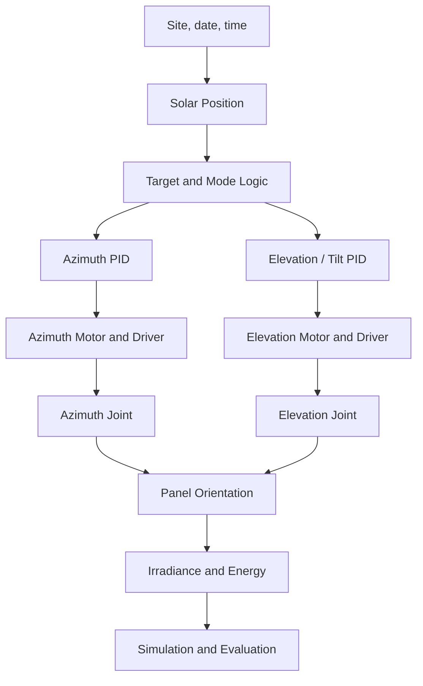

# ☀️ Solar Tracker Control Simulation

### Solar Tracking System Modeling and Control Simulation

[](https://github.com/JhonsJSSimatupang/Solar-Tracker-Control-Simulation)
[](https://www.mathworks.com/academia/student-challenge/mathworks-excellence-in-innovation-signup.html?tfa_1=Solar+Tracker+Control+Simulation&tfa_2=249)
[](https://www.mathworks.com/products/matlab.html)
[](https://www.mathworks.com/products/simulink.html)
[](LICENSE)

---

## 📌 Overview

Solar energy systems are widely used as a renewable energy source. However, the amount of solar energy captured by a photovoltaic (PV) panel depends partly on its orientation relative to the sun.

A solar tracking system is designed to adjust the panel's orientation to follow the apparent movement of the sun, with the aim of improving solar energy collection.

This project focuses on the study, design, and simulation of a **dual-axis azimuth–elevation solar tracking control system** using MATLAB and Simulink. The development process covers system modeling, control strategy development, simulation, and performance evaluation. The baseline configuration rotates the panel about a vertical azimuth axis and a horizontal elevation (tilt) axis; a single-axis azimuth case is retained for comparison and as a candidate degraded mode.

The project is developed as a Capstone Project, with this repository serving as the central workspace for source code, simulation models, supporting data, results, and technical documentation.

> **Project Focus:** Solar tracking systems, control system modeling, MATLAB/Simulink simulation, and performance evaluation.

---

## 🎯 Objectives

- Study the fundamental principles of solar tracking systems.
- Understand the relationship between solar position and photovoltaic panel orientation.
- Define the system requirements for a dual-axis azimuth–elevation tracker.
- Develop mathematical and simulation models using MATLAB and Simulink.
- Design and implement the azimuth and elevation controllers.
- Compare fixed, single-axis, and dual-axis energy performance.
- Evaluate system behavior under selected operating conditions.
- Analyze simulation results and identify potential improvements.

---

## 🧠 System Concept

The project explores a solar tracking system through a modeling and simulation workflow.

The dual-axis workflow selected at Gate G1 is illustrated below:



The diagram shows the architecture selected at Gate G1. The detailed requirements and interfaces are documented in [System Design](docs/SYSTEM_DESIGN.md). The Simulink/Simscape implementation is the next stage.

---

## 🛠️ Technologies

| Technology | Purpose |
|---|---|
| MATLAB | Mathematical modeling, computation, and data analysis |
| Simulink | System modeling and dynamic simulation |
| Simscape | Physical network modeling |
| Simscape Multibody | Two-axis mechanical tracker model |
| Simscape Electrical | DC motor and driver model |
| Control System Toolbox | PID design and linear analysis |
| Simulink Control Design | Controller tuning and analysis |
| Stateflow | Operating-mode logic |
| MATLAB Unit Test Framework | Automated unit, integration, and regression tests |
| Git / GitHub | Version control and repository documentation |

The first three products (MATLAB, Simulink, Stateflow) are installed. The
Simscape and Control System Toolbox products are required for the model stage
and are not installed yet; see [Environment Setup](docs/SETUP.md).

---

## 📂 Repository Structure

```text
Solar-Tracker-Control-Simulation/
│
├── README.md
├── LICENSE
├── .gitignore
├── run_project.m
│
├── models/
│   ├── libraries/
│   └── (solar_tracker.slx)
│
├── src/
│   ├── initialization/
│   ├── sun_position/
│   ├── controllers/
│   └── analysis/
│
├── data/
│   └── sample/
│
├── results/
│   ├── figures/
│   │   └── axis_comparison.png
│   └── metrics/
│       └── axis_comparison.csv
│
├── docs/
│   ├── PROJECT_PLAN.md
│   ├── DEVELOPMENT_LOG.md
│   ├── SETUP.md
│   ├── WORKFLOW.md
│   ├── TEST_PLAN.md
│   ├── AI_USAGE_LOG.md
│   ├── SYSTEM_DESIGN.md
│   ├── REFERENCES.md
│   ├── design/
│   │   └── G2_DESIGN_CALCULATIONS.md
│   └── references/
│
└── tests/
    ├── unit/
    │   ├── test_solar_position.m
    │   ├── test_target_angles.m
    │   ├── test_axis_comparison.m
    │   └── test_design_sizing.m
    ├── check_environment.m
    └── run_unit_tests.m
```

| Path             | Description                                                         |
| ---------------- | ------------------------------------------------------------------- |
| `run_project.m`  | Single entry point that runs the full simulation end-to-end         |
| `models/`        | Simulink models and reusable libraries                              |
| `src/`           | MATLAB source code: initialization, sun position, control, analysis |
| `data/`          | Input data and supporting datasets                                  |
| `results/`       | Simulation figures and quantitative metrics                         |
| `docs/`          | Project planning, design, references, and development records       |
| `tests/`         | Automated tests and verification scripts                            |

---

## 🚀 Getting Started

### Prerequisites

| Product | Version | Status |
|---|---|---|
| MATLAB | R2026a Update 4 | Installed |
| Simulink | R2026a | Installed |
| Stateflow | R2026a | Installed |
| Simscape | R2026a | Required, not installed |
| Simscape Multibody | R2026a | Required, not installed |
| Simscape Electrical | R2026a | Required, not installed |
| Control System Toolbox | R2026a | Required, not installed |
| Simulink Control Design | R2026a | Required, not installed |

The unit tests in `tests/unit/` run with MATLAB alone. The Simulink model
requires the missing products. Installation steps and the Gate G0 checklist are
in [Environment Setup](docs/SETUP.md).

### Installation

Clone the repository:

```bash
git clone https://github.com/JhonsJSSimatupang/Solar-Tracker-Control-Simulation.git
```

Navigate to the project directory:

```bash
cd Solar-Tracker-Control-Simulation
```

Open the project directory in MATLAB or Visual Studio Code.

Run the main entry point from MATLAB:

```matlab
run_project
```

The entry point adds the source folders to the MATLAB path, loads the project
parameters from `src/initialization/setup_project.m`, and runs the main
Simulink model in `models/solar_tracker.slx`. The model is added at Gate G3;
until then, `run_project` reports that the model file is missing.

To run the unit tests:

```matlab
addpath('tests');
results = run_unit_tests();
assertSuccess(results);
```

The current suite has 24 tests covering the solar position, target angles, axis
comparison, and actuator sizing.

To regenerate the annual axis comparison:

```matlab
addpath(genpath('src'));
results = compare_tracker_axes('WriteFiles', true);
```

---

## 🧪 Simulation and Testing

The project will investigate system behavior through simulation under selected operating conditions.

Initial testing areas may include:

| Test area | Description | Status |
|---|---|---|
| Solar position | Azimuth and elevation against NREL SPA and physical invariants | Unit tests passing (10/10) |
| Target angles | Azimuth and panel-tilt commands, clamping, and night stow | Unit tests passing (5/5) |
| Axis comparison | Annual fixed, single-axis, and dual-axis energy proxy | Completed; CSV and PNG generated |
| Actuator sizing | Torque, current, voltage, and speed margins for both axes | Unit tests passing (5/5) |
| Baseline operation | Observe the initial two-axis system behavior | Pending Simscape model |
| Tracking response | Evaluate the azimuth and elevation control loops | Pending model |
| Control performance | Analyze the selected control approach | Pending model |
| System performance | Evaluate the overall simulation performance | Pending model |
| Fault handling | Detect a motor or sensor fault and enter a safe state | Planned (advanced) |

The numerical test cases and pass criteria are documented in
[Test Plan](docs/TEST_PLAN.md).

---

## 📊 Simulation Results

### Current results — axis screening

The annual direct-beam proxy for Malang 2026 is available. It uses the
NOAA/Meeus solar position and a Meinel clear-sky direct-beam model. Diffuse
irradiance and actuator energy are not included yet, so the absolute values are
screening estimates, not the final energy result.

| Configuration | Energy (kWh/m²/year) | Gain vs fixed |
|---|---:|---:|
| Fixed, optimal tilt 8° | 2276.6 | — |
| Single-axis azimuth, optimal tilt 43° | 3062.2 | +34.5% |
| Horizontal north–south single-axis | 3115.4 | +36.8% |
| Dual-axis (ideal) | 3264.5 | +43.4% |

Generated files:

- [`results/metrics/axis_comparison.csv`](results/metrics/axis_comparison.csv)
- [`results/figures/axis_comparison.png`](results/figures/axis_comparison.png)

### Current results — preliminary actuator sizing

The Gate G2 static sizing selects 100:1 and 150:1 worm gears and verifies the
preliminary 24 V DC motors. The full calculation is in
[G2 Design Calculations](docs/design/G2_DESIGN_CALCULATIONS.md).

| Quantity | Azimuth | Elevation |
|---|---:|---:|
| Required output torque | 11.40 N·m | 17.06 N·m |
| Motor torque | 0.163 N·m | 0.162 N·m |
| Motor current | 3.26 A | 3.25 A |
| Current limit | 5.0 A | 5.0 A |
| Torque margin | 1.54 | 1.54 |
| Speed margin | 137.5 | 91.7 |

The elevation axis needs about 1.12 A to hold the panel at tilt 0°; a
self-locking gear or a holding brake can avoid this holding energy at night.

### Planned results

- Solar tracking response on both axes.
- PV panel orientation and angle of incidence.
- Azimuth and elevation controller step responses.
- Net energy including actuator consumption.
- Performance comparison under clear, cloudy, rainy, and night conditions.
- Fault detection and safe-state behavior.

Simulation figures, quantitative measurements, and performance conclusions will
be added after the corresponding experiments have been completed.

---

## 📚 Documentation

| Document                                   | Description                                             |
| ------------------------------------------ | ------------------------------------------------------- |
| [Project Plan](docs/PROJECT_PLAN.md)       | Project objectives, scope, and development roadmap      |
| [Development Log](docs/DEVELOPMENT_LOG.md) | Chronological record of project activities and progress |
| [Environment Setup](docs/SETUP.md)         | MATLAB, toolbox, and development tool preparation       |
| [Workflow](docs/WORKFLOW.md)               | Execution phases, review gates, and AI usage protocol   |
| [Test Plan](docs/TEST_PLAN.md)             | Test levels, test cases, pass criteria, and traceability |
| [AI Usage Log](docs/AI_USAGE_LOG.md)       | Record of generative AI use and verification            |
| [System Design](docs/SYSTEM_DESIGN.md)     | System architecture and design decisions                |
| [References](docs/REFERENCES.md)           | Research papers and technical resources                 |

Additional technical documentation will be maintained in the `docs/` directory as the project develops.

---

## 🎓 Capstone Project

This repository is developed as part of the Solar Tracker Control Simulation Capstone Project.

The project is also associated with **MathWorks Excellence in Innovation**, under the following project registration:

| Information               | Details                          |
| ------------------------- | -------------------------------- |
| Project Title             | Solar Tracker Control Simulation |
| Project ID                | 249                              |
| Project Type              | Capstone Project                 |
| Main Development Platform | MATLAB and Simulink              |
| Current Stage             | Gate G2 — preliminary actuator sizing complete; model blocked by missing products |

Related program:

- [MathWorks Excellence in Innovation](https://www.mathworks.com/academia/student-challenge/mathworks-excellence-in-innovation-signup.html?tfa_1=Solar+Tracker+Control+Simulation&tfa_2=249)

---

## 👤 Project Author

**Jhons Janner Samuel S.**

Capstone Project Developer

---

## 📄 License

This project is distributed under the BSD 2-Clause License. See the [LICENSE](LICENSE) file for details.

---

<p align="center">
  <i>Building, modeling, and evaluating solar tracking systems through simulation.</i>
</p>

<p align="center">
  Developed as a Capstone Project using MATLAB and Simulink.
</p>
