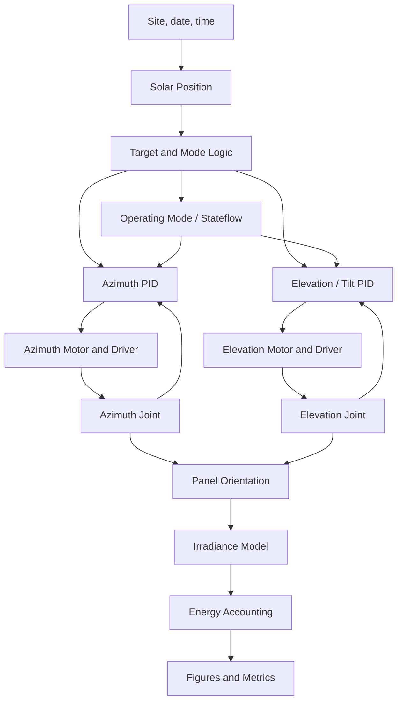

# 🧩 System Design

## Solar Tracker Control Simulation

> **Status:** Requirements baseline (Gate G1) — dual-axis configuration selected,
> pending formal team sign-off.
>
> **Scope:** simulation only. No physical hardware is required.

This document defines the system requirements, architecture, interfaces, and
design decisions for the solar tracker control simulation.

---

## 1. Purpose

The system simulates a dual-axis solar tracker that rotates a photovoltaic (PV)
panel about a vertical azimuth axis and a horizontal elevation (tilt) axis to
follow the sun's apparent path. The objective is to increase the irradiance
received by the panel compared with a fixed installation.

The project is a control-engineering study. The main question is not only
"can the panel follow the sun?" but also "does two-axis tracking produce a net
energy gain after the actuator consumption of both axes is subtracted?"

---

## 2. Scope

### In scope

- A dual-axis azimuth–elevation tracker.
- A solar position algorithm for any date, time, and site.
- A target-angle generator for both axes with deadband and night-stow logic.
- Two PID controllers, one for azimuth and one for panel tilt.
- Two DC gear-motor models in Simscape Electrical.
- A two-axis mechanical tracker model in Simscape Multibody.
- A clear-sky irradiance and energy model.
- A comparison of fixed, single-axis azimuth, horizontal north–south, and
  dual-axis configurations.
- Scenario simulations for clear, cloudy, rainy, sunrise, sunset, and night.
- Unit, integration, scenario, and regression tests.

### Out of scope (unless time permits)

- A third (roll/polar) axis.
- MPPT, battery storage, and grid connection.
- Machine-learning sun prediction.
- Physical hardware, PCB design, and manufacturing actuator sizing.

The dual-axis baseline directly addresses the multi-axis project brief. A
single-axis azimuth case is retained in the energy analysis for comparison and
as a candidate degraded mode; it is not the main simulation model.

---

## 3. Assumptions and Constraints

| ID | Assumption or constraint |
|---|---|
| A-01 | The installation site is Malang, East Java, Indonesia: latitude -7.9666°, longitude 112.6326°, UTC+7. |
| A-02 | The panel is mounted on a two-axis gimbal: azimuth (yaw) about a vertical axis and elevation (tilt) about a horizontal axis. There is no fixed panel tilt. |
| A-03 | The azimuth axis has a mechanical range of at least 0° to 360°. |
| A-04 | The elevation axis sets the panel tilt from horizontal. The preliminary range is 0° to 85°; the upper limit avoids the gimbal singularity at zenith and reduces wind load. |
| A-05 | Each axis is driven by a brushed DC gear motor supplied by an H-bridge driver. |
| A-06 | The controller runs at a fixed sample time of 0.01 s. The energy calculation uses a 1 s sample time. Full-day runs may use a 0.1 s solver step, to be confirmed at Gate G3. |
| A-07 | Weather data are represented by a clear-sky model and optional NASA POWER or BMKG samples. |
| A-08 | The model must run on MATLAB R2026a with the products listed in `docs/SETUP.md`. |
| A-09 | All parameters are defined in `src/initialization/project_config.m` and loaded by `setup_project.m`; no model block contains a hard-coded design parameter. |
| A-10 | The elevation axis carries the panel and frame; the gravity torque on the elevation axis is included in the mechanical model. |

Angle conventions:

- Azimuth is measured clockwise from north, 0° to 360°.
- Panel tilt is measured from the horizontal plane: 0° = horizontal,
  90° = vertical.
- The elevation-axis command is the panel tilt, **not** the solar elevation.
  To face the sun, the target tilt is `90° - sun elevation`.

---

## 4. Functional Requirements

The acceptance criteria are preliminary baseline targets. They are confirmed or
revised at Gate G2 after the motor and mechanical design calculations.

| ID | Requirement | Acceptance criterion | Verification |
|---|---|---|---|
| FR-01 | Compute the solar azimuth and elevation for a given site and time. | Azimuth and geometric elevation within 0.1° of NREL SPA/NOAA reference values. | Unit tests |
| FR-02 | Generate target angles for both axes. | Azimuth target equals the sun azimuth; tilt target equals `90° - sun elevation`; both are clamped to the mechanical limits. Night-stow target is applied when elevation < 0°. | Unit tests and simulation |
| FR-03 | Apply deadband and mode logic. | No actuator command inside the deadband; no chattering at mode boundaries. | Unit tests and simulation |
| FR-04 | Control the azimuth axis. | For a 30° step: settling time ≤ 15 s, overshoot ≤ 10%, steady-state error ≤ 0.2°. | Model test |
| FR-05 | Control the elevation (tilt) axis. | For a 20° step: settling time ≤ 15 s, overshoot ≤ 10%, steady-state error ≤ 0.2°. | Model test |
| FR-06 | Track the moving sun on both axes. | RMS azimuth error ≤ 0.5° and RMS tilt error ≤ 0.5° during a clear day. | Integration test |
| FR-07 | Model both actuators. | Motor speed and torque follow the motor equations; voltage and current are limited. | Model test |
| FR-08 | Model the two-axis mechanical tracker. | Axes move in the correct direction, respect limits, and have no singularities in the 0°–85° tilt range. | Model test and Model Advisor |
| FR-09 | Compute the irradiance on the panel. | Angle of incidence and plane-of-array irradiance match hand calculations within 1%. | Unit test |
| FR-10 | Compute captured and consumed energy. | Daily energy values match numerical integration within 1%; actuator energy from both axes is included. | Unit test and simulation |
| FR-11 | Run the defined operating scenarios. | Clear, cloudy, rainy, sunrise, sunset, and night scenarios complete without solver errors. | Scenario tests |
| FR-12 | Detect and respond to a fault. | A motor or sensor fault is detected and the tracker enters a safe state. | Scenario test |
| FR-13 | Produce a reproducible result set. | `run_project.m` regenerates the figures and metrics from a clean clone. | Reproducibility test |

### Advanced requirements (stretch)

| ID | Requirement | Acceptance criterion |
|---|---|---|
| FR-A1 | Add a third (roll/polar) axis. | Third-axis tracking error ≤ 0.5° RMS; energy gain reported against the dual-axis case. |
| FR-A2 | Compare PID with an advanced controller. | Same scenarios; performance and control effort compared in a table. |
| FR-A3 | Provide an interactive dashboard. | User can change date, site, weather, and controller gains and see the response. |

---

## 5. Non-Functional Requirements

| ID | Requirement | Acceptance criterion |
|---|---|---|
| NFR-01 | Single entry point. | `run_project.m` runs the complete analysis without manual steps. |
| NFR-02 | Clean-install reproducibility. | A clean MATLAB installation with the documented products can run the project. |
| NFR-03 | Centralized parameters. | All design parameters are defined in `project_config.m`, loaded by `setup_project.m`, and passed to the model. |
| NFR-04 | Traceability. | Every requirement maps to a design element and a test in `docs/TEST_PLAN.md`. |
| NFR-05 | Runtime. | A 24-hour simulation completes in ≤ 10 minutes on the target laptop at the documented full-day solver step. |
| NFR-06 | Code quality. | Code Analyzer reports no errors; Model Advisor reports no unresolved errors. |
| NFR-07 | Documentation. | README, system design, test plan, and results are complete and consistent. |
| NFR-08 | AI transparency. | Every non-trivial AI-assisted change is recorded in `docs/AI_USAGE_LOG.md`. |
| NFR-09 | Offline execution. | The test suite runs without an internet connection using synthetic inputs generated in code. |
| NFR-10 | License. | The repository uses an open-source license (BSD-2-Clause or MIT). |

---

## 6. System Architecture



The two controllers and the two plant axes form two closed loops. The solar
position and the irradiance model are feed-forward inputs; they do not depend
on the panel orientation, except through the angle of incidence.

The azimuth and elevation loops are mechanically coupled through the panel, but
the coupling is weak at the tracking speeds of interest. Each axis is therefore
controlled by its own PID loop, with the coupling verified in the integrated
simulation.

---

## 7. Subsystems

### 7.1 Solar Position

- **Inputs:** site latitude, longitude, UTC offset, date, time.
- **Outputs:** solar azimuth, geometric elevation, zenith, declination, hour
  angle, equation of time.
- **Algorithm:** NOAA/Meeus equations, implemented in
  `src/sun_position/solar_position.m`.
- **Validation:** NREL SPA reference case and physical invariants (east in the
  morning, west in the afternoon, equinox noon elevation).
- **Accuracy:** the implementation matches the NREL SPA geometric elevation to
  better than 0.01° and the azimuth to better than 0.01° for the reference
  case.

### 7.2 Target and Mode Logic

The target generator converts the sun position into commands for both axes.

| Mode | Condition | Target / action |
|---|---|---|
| `DAY_TRACK` | Sun elevation > 0° and either axis error > deadband | Azimuth target = sun azimuth; tilt target = `90° - sun elevation`; both clamped to limits |
| `DEADBAND_HOLD` | Sun elevation > 0° and both errors ≤ deadband | Hold the last target on each axis |
| `NIGHT_STOW` | Sun elevation ≤ 0° | Move to the stow position and stop |
| `CLOUD_HOLD` | Cloud cover above threshold | Hold position to save actuator energy |
| `FAULT_SAFE` | Fault detected | Disable both motors and hold the axes; latch until reset |

The priority is `FAULT_SAFE`, then `NIGHT_STOW`, then `CLOUD_HOLD`, then the
normal day modes. The reference implementation is
`src/controllers/tracker_mode_logic.m`; the Stateflow chart or MATLAB Function
block reproduces the same logic.

- **Night hysteresis:** enter stow at or below 0° solar elevation and leave
  stow only above 2°. This prevents chattering at sunrise and sunset.
- **Deadband:** update the target when either axis error exceeds 0.5°;
  otherwise hold the previous target and disable the motors.
- **Fault:** a fault latches the safe state until `ResetFault` is true and the
  fault input is clear.
- **Azimuth error:** wrapped to the shortest signed angle in ±180°.

The deadband is a configurable parameter per axis (preliminary value: 0.5°).

The tilt conversion is explicit in the implementation:

```matlab
targetAzimuth = sun.azimuth;
targetTilt    = 90 - sun.elevation;
```

A night-stow position of azimuth 0° (north) and tilt 0° (horizontal) is used as
the preliminary value. The final stow position is confirmed at Gate G2.

### 7.3 Controllers

Two independent PID loops, one per axis, both running at the configured 10 ms
control step.

- Inputs: azimuth error and tilt error (target minus measured), plus the
  measured angle for the derivative path.
- Outputs: armature voltage commands, which the plant converts to motor torque.
- Structure:
  - **P** — proportional gain `Kp` on the angle error.
  - **I** — integral gain `Ki` with the integrator clamped to the voltage
    limit, so the integral term cannot wind up while the drive saturates.
  - **D** — filtered derivative `Kd·wf·s/(s + wf)` applied to the *measurement*,
    not to the error. Differentiating the measurement avoids a derivative kick
    whenever the target steps, which matters because the solar target is a
    slowly moving ramp that occasionally jumps at mode changes.
  - **Rate limit** — 2400 V/s, enough to swing the full 24 V rail inside one
    10 ms step. An earlier 48 V/s value delayed braking by about half a second
    and was the dominant cause of overshoot on a 30° step.
  - **Saturation** — ±24 V, the supply rail.

Two gain sets exist because the two models have very different voltage-to-angle
gains:

| Model | `Kp` | `Ki` | `Kd` | `wf` (rad/s) | Purpose |
|---|---|---|---|---|---|
| `solar_tracker.slx` (reduced order) | 1.0 | 0.1 | — | — | 24 h energy study, PI only |
| `solar_tracker_plant.slx` (Simscape) | 1.2 | 0.3 | 0.2 | 20 | Control and actuator validation |

Measured closed-loop behaviour on the Simscape plant: 8.07 % azimuth overshoot,
6.84 % tilt overshoot, 7.43 s / 7.18 s settling, 0.011° / 0.007° steady-state
error, and 5.000 A peak armature current on both axes (the current ceiling).

The elevation loop additionally rejects the gravity torque of the panel. The
gravity lever arm is `m·g·L·cos(tilt)`, so the disturbance is largest when the
panel is horizontal and vanishes when it is vertical. The azimuth loop rejects
a constant wind torque.

The reduced-order model is deliberately a PI on a pure integrator at a 1 s step.
It is the daily-energy workhorse: it runs 24 h in seconds, and the absolute
angle errors it produces are validated against the plant model over short
horizons. The full PID, the rate limiter, and the 10 ms step are exercised in
`solar_tracker_plant.slx`.

### 7.4 Actuators and Motors

Two brushed DC gear motors are used for the baseline. Each axis plant is built
from Simscape primitives in `models/build_axis_plant.m` rather than from the
library DC Motor block, so that every equation and every parameter is visible
and auditable.

The plant solves two coupled first-order equations:

```
electrical   V = Ra*i + La*di/dt + Ke*omega
mechanical   J_eq*domega/dt = Kt*i - T_friction - T_dist/(eta*N)
```

with the load inertia reflected through the gear:

```
J_eq = J_load/N^2 + J_motor          theta_load = theta_motor/N
```

The H-bridge is modelled as a voltage source with a current ceiling. Since
`i = (V - Ke*omega)/Ra`, the constraint `|i| <= currentLimit` is exactly a
voltage window:

```
V in [Ke*omega - Ra*currentLimit,  Ke*omega + Ra*currentLimit]
```

The window bounds depend only on the shaft speed, which is a state, so the
clamp adds no algebraic loop. The drive therefore behaves like a
torque-limited amplifier: constant current during acceleration, voltage
control once the back-EMF leaves room for the command. The voltage actually
applied is logged, so the energy integral uses the real terminal voltage
rather than the raw controller output.

Friction is a `Rotational Friction` block with separate breakaway, Coulomb, and
viscous terms, so stiction and the unpowered holding behaviour can be studied.
Gear efficiency appears as a torque scaling `1/(eta*N)` on the disturbance, so
the electrical energy drawn for a given load already includes the gear loss.

Verification is done against closed-form results in
`models/verify_axis_plant.m`: no-load steady state, current ceiling, and speed
rise time. The parameters are listed in §10.

The azimuth stage uses a worm gear. The elevation stage uses a worm gear with
a high ratio; the final motor choice is confirmed at Gate G2. The motor and
gear parameters come from a torque calculation that includes panel inertia,
gravity torque, bearing friction, and wind disturbance.

### 7.5 Mechanical Tracker

- One revolute degree of freedom per axis: azimuth (vertical) and elevation
  (horizontal).
- The plant is a lumped-parameter rotational model: inertia, friction, and a
  reflected gear ratio. It reproduces the joint dynamics without the modelling
  and solver cost of a multibody assembly.
- A worm gear prevents back-driving on both axes when the motor is unpowered.
- Panel dimensions, mass, center of mass, and inertia are parameters.
- Joint limits, damping, and friction are documented in §10.
- The tilt range is limited to 0°–85° to avoid the gimbal singularity at
  zenith, where the azimuth is undefined.
- The gravity torque on the elevation axis is a function of the load angle and
  is applied as a disturbance input to the plant.

### 7.6 Irradiance and Energy

The energy model is implemented in `src/energy/` and computes:

- Solar incidence angle from the sun vector and the panel normal.
- Direct normal irradiance (DNI), diffuse horizontal irradiance (DHI), and
  global horizontal irradiance (GHI) with a Meinel clear-sky model.
- Plane-of-array irradiance with the isotropic sky model.
- Instantaneous PV power with a linear efficiency model, then daily energy.
- Actuator electrical energy for both axes from voltage and current.
- Net energy = captured PV energy − actuator energy.

| Module | Function |
|---|---|
| `clear_sky_irradiance.m` | DNI, DHI, and GHI from the solar elevation |
| `plane_of_array_irradiance.m` | Isotropic POA irradiance on a tilted panel |
| `energy_metrics.m` | PV and actuator energy integration |
| `tracker_actuator_energy.m` | Quasi-static DC-motor power for both axes |
| `daily_energy_simulation.m` | Full-day PV and net energy for one configuration |
| `compare_daily_energy.m` | Fixed, azimuth, and dual-axis daily comparison |

The clear-sky model uses the Meinel direct-beam expression
`DNI = 1.353 × 0.7^(AM^0.678)` with `AM = 1/sin(elevation)`, a constant diffuse
fraction `DHI = 0.10 × DNI`, and a ground albedo of 0.20. The model is a
screening model; measured NASA POWER or BMKG data can replace it in the
scenario tests.

The analysis script `src/analysis/compare_tracker_axes.m` compares four cases
with the direct-beam proxy:

1. Fixed panel at the optimal tilt.
2. Single-axis azimuth tracker at the optimal fixed tilt.
3. Horizontal north–south single-axis tracker.
4. Ideal dual-axis tracker (panel normal follows the sun).

The first-pass direct-beam proxy for Malang 2026 gives +43.4% for the ideal
dual-axis case relative to the fixed optimum. The daily model, which includes
diffuse and ground-reflected irradiance, gives +33.4% on 2026-03-21, +40.1% on
2026-06-21, and +47.0% on 2026-12-21 for captured PV energy. After actuator
energy the dual-axis gain is +31.4%, +37.9%, and +44.9% respectively; the
tracker pays 36 Wh/day for its own motion on the equinox. The daily model is
the more realistic estimate; the annual proxy is retained as a fast screening
tool.

The actuator power comes from `tracker_actuator_energy`, a quasi-static torque
balance at each sample. For each axis:

```
moving    T_motor = (T_dist + T_friction*sign(w)) / (eta*N)
holding   T_motor = sign(T_dist)*max(0, |T_dist| - T_friction) / (eta*N)
I = |T_motor| / Kt,      V = Ke*|w_motor| + Ra*I,      P = V*I
```

`T_dist` is the tilt-dependent gravity torque `m·g·L·cos(tilt)` on elevation
and the mean wind torque on azimuth. The model assumes a non-self-locking worm
gear, so the elevation motor holds the panel against gravity all night. Braking
energy is dissipated rather than recovered, because the drive has no
regeneration path. Acceleration torque is omitted: at the 1–5 minute sample
rates used for a daily run it is orders of magnitude below friction and gravity.

---

## 8. Interfaces

| Interface | From | To | Signal / Data | Unit |
|---|---|---|---|---|
| I-01 | Solar position | Target logic | Sun azimuth | deg |
| I-02 | Solar position | Target logic | Sun elevation | deg |
| I-03 | Target logic | Azimuth controller | Target azimuth | deg |
| I-04 | Target logic | Elevation controller | Target panel tilt | deg |
| I-05 | Mechanical tracker | Azimuth controller | Measured azimuth | deg |
| I-06 | Mechanical tracker | Elevation controller | Measured panel tilt | deg |
| I-07 | Azimuth controller | Azimuth driver | Voltage command | V |
| I-08 | Elevation controller | Elevation driver | Voltage command | V |
| I-09 | Azimuth motor | Azimuth joint | Torque | N·m |
| I-10 | Elevation motor | Elevation joint | Torque | N·m |
| I-11 | Mechanical tracker | Energy model | Panel azimuth | deg |
| I-12 | Mechanical tracker | Energy model | Panel tilt | deg |
| I-13 | Solar position | Energy model | Sun vector | — |
| I-14 | Energy model | Results | PV energy, actuator energy | Wh |

Sign conventions:

- Azimuth is clockwise from north, 0° to 360°.
- Panel tilt is measured from horizontal, 0° to 85°.
- Positive azimuth torque rotates the panel clockwise when viewed from above.
- Positive elevation torque increases the panel tilt (raises the panel toward
  vertical).
- Positive azimuth error means the panel must rotate clockwise.
- Positive tilt error means the panel must be raised toward vertical.

---

## 9. Design Decisions

| Date | Decision | Rationale | Status |
|---|---|---|---|
| 2026-11-09 | Site: Malang (-7.9666°, 112.6326°, UTC+7). | Home campus location; equatorial site with high solar elevation; data available from NASA POWER and BMKG. | Proposed |
| 2026-11-09 | Baseline axis: dual-axis azimuth–elevation. | Directly addresses the multi-axis project brief; the direct-beam proxy shows the highest energy gain (+43.4%) and both axes are controlled. | Accepted (team decision) |
| 2026-11-09 | Single-axis azimuth retained as an analysis case. | Provides a fair tracking comparison and a candidate degraded mode if the elevation actuator fails. | Accepted |
| 2026-11-09 | Advanced extension: third (roll/polar) axis. | Adds a further tracking degree of freedom only if the dual-axis baseline is completed on schedule. | Optional |
| 2026-11-09 | Solar position: NOAA/Meeus. | Accuracy better than 0.02°, simple implementation, no additional toolbox, validated against NREL SPA. | Accepted |
| 2026-11-09 | Controllers: two PID loops. | Standard, transparent, and supported by Control System Toolbox. An advanced controller is compared only after the PID baseline passes. | Proposed |
| 2026-11-09 | Motors: brushed DC gear motors. | Simple electrical model, suitable for a small panel, and supported by Simscape Electrical. | Proposed |
| 2026-11-09 | Mechanics: worm gear on azimuth, worm gear or brake on elevation. | The Simscape example provides a starting point; the worm gear holds position when unpowered. | Proposed |
| 2026-11-09 | Panel tilt: no fixed tilt; set by the elevation axis. | The second axis removes the fixed-tilt compromise and lets the panel normal follow the sun. | Accepted (consequence of dual-axis) |
| 2026-11-09 | Energy metric: net energy after actuator consumption. | A tracker that captures more irradiance but consumes more actuator energy may not be worth it; the net metric answers the engineering question. | Proposed |
| 2026-11-09 | Preliminary gear ratios: 100:1 azimuth, 150:1 elevation. | The G2 static sizing gives a required output torque of 11.4 N·m and 17.1 N·m. Both ratios keep the motor current below 3.3 A against a 5 A limit and give a torque margin of about 1.54. | Accepted (preliminary) |
| 2026-11-09 | Preliminary motor: 24 V brushed DC, `K_t = 0.05 N·m/A`, `R = 1.2 Ω`. | Representative parameters for the simulation; the final motor is confirmed at Gate G3. | Accepted (preliminary) |
| 2026-11-09 | Elevation holding: worm gear or brake to be decided at G3. | The holding current at tilt 0° is 1.12 A (1.5 W); a self-locking gear or brake can avoid the holding energy. | Open |
| 2026-11-11 | Axis plants built from Simscape primitives, not Simscape Multibody. | Every equation and parameter stays visible and auditable; Multibody would add a product dependency and a large rigid-body model for a two-degree-of-freedom problem. | Accepted |
| 2026-11-11 | Two models: reduced-order baseline for the 24 h study, Simscape plant for control validation. | A 10 ms step over 24 h needs 8.6 million fixed steps, which is not affordable on the project hardware. The plant model is used for short-horizon control and actuator validation. | Accepted |
| 2026-11-11 | 10 ms control step with Simscape local solvers in the plant model. | Local solvers let a fixed-step parent model host the physical networks; the 10 ms rate matches the documented loop bandwidth. | Accepted |
| 2026-11-11 | Filtered derivative on the measurement, not on the error. | Avoids a derivative kick at every target step, which is frequent at mode changes. | Accepted |
| 2026-11-11 | Voltage rate limit 2400 V/s (full rail in one step). | 48 V/s delayed braking by about half a second and was the dominant cause of step overshoot. The drive can realistically slew the rail within one control step. | Accepted |
| 2026-11-11 | Separate gain sets for the reduced-order and plant models. | The two plants differ by orders of magnitude in voltage-to-angle gain; one gain set cannot serve both. | Accepted |

---

## 10. Preliminary Parameters

These values are the Gate G2 preliminary design. They are not final; the
dynamic model at Gate G3 confirms them. The full calculation is in
[G2 Design Calculations](design/G2_DESIGN_CALCULATIONS.md).

| Parameter | Preliminary value | Notes |
|---|---|---|
| Panel width × height | 1.0 m × 1.6 m | About 1.6 m² |
| Panel mass | 12 kg | Frame and cells |
| Panel centre-of-mass offset | 0.05 m | Along the panel height |
| Azimuth range | 0° to 360° | Continuous rotation or limited range |
| Elevation (tilt) range | 0° to 85° | Avoids the zenith singularity |
| Stow position | Azimuth 0°, tilt 0° | Horizontal, low wind load |
| Deadband | 0.5° per axis | Reduce actuator wear |
| Azimuth gear ratio | 100:1 | Selected by the G2 torque calculation |
| Elevation gear ratio | 150:1 | Selected by the G2 torque calculation |
| Gear efficiency | 0.70 | Worm-gear estimate |
| Friction torque | 1.0 N·m per axis | Bearing and seal estimate |
| Design acceleration | 0.05 rad/s² | Worst-case sizing |
| Design slew rate | 2°/s | Worst-case sizing |
| Wind torque allowance | 10 N·m per axis | Static worst-case gust |
| Panel inertia about tilt axis | 3.5 kg·m² | Includes frame and hardware |
| Panel inertia about azimuth axis | 8.0 kg·m² | Includes frame and hardware |
| Motor rated voltage | 24 V | Both axes |
| Motor armature resistance | 1.2 Ω | Preliminary motor |
| Motor torque constant | 0.05 N·m/A | Preliminary motor |
| Motor back-EMF constant | 0.05 V·s/rad | Preliminary motor |
| Motor current limit | 5 A | Driver limit |
| Controller sample time | 0.01 s | Plant model; the reduced-order baseline uses 1 s |
| Controller voltage rate limit | 2400 V/s | Plant model only |
| Plant PID gains `Kp`/`Ki`/`Kd` | 1.2 / 0.3 / 0.2 | Simscape plant, per axis |
| Derivative filter | 20 rad/s | Simscape plant, per axis |
| Mean wind torque (simulation) | 2.0 N·m | 20 % of the 10 N·m sizing allowance |
| Energy sample time | 1 s | Preliminary |
| Full-day solver step | 0.1 s | Preliminary; controller tests use 0.01 s |
| Simulation duration | 24 h | One full day |
| PV conversion efficiency | 18% | Preliminary linear model |

The sizing results are:

| Quantity | Azimuth | Elevation |
|---|---:|---:|
| Required output torque | 11.40 N·m | 17.06 N·m |
| Motor torque | 0.163 N·m | 0.162 N·m |
| Motor current | 3.26 A | 3.25 A |
| Torque margin | 1.54 | 1.54 |
| Speed margin | 137.5 | 91.7 |

The values are recorded in `src/initialization/project_config.m` and in
`docs/design/G2_DESIGN_CALCULATIONS.md`.

---

## 11. Open Issues

- [x] Confirm the axis baseline: dual-axis azimuth–elevation selected on
  2026-11-09.
- [ ] Obtain formal team sign-off on Gate G1.
- [x] Calculate the panel inertia and the required torque for both axes.
- [x] Select the preliminary motors and gear ratios for both axes.
- [ ] Confirm the motor and gearbox selection with the dynamic model at Gate G3.
- [x] Define the exact PID step-response targets after the plant model exists.
  Overshoot ≤ 10 %, settling ≤ 20 s, steady-state error ≤ 0.2°, peak current
  ≤ 1.02 × current limit, tracking RMSE ≤ 0.5°, tracking max error ≤ 2.0°.
- [x] Define the stow position and the mechanical limits.
- [x] Select the clear-sky irradiance model.
- [x] Validate the tilt and energy estimates with a diffuse sky model.
- [ ] Add a measured or scenario-based weather data source.
- [ ] Decide whether the third axis is included in the final submission.
- [x] Install the required products for Gate G0.

---

## 12. References

See [REFERENCES.md](REFERENCES.md).
