# 🔄 Project Workflow

## Solar Tracker Control Simulation

> **Purpose:** define how the project is planned, executed, reviewed, tested, and documented. This document is the team's working agreement and the checklist for the final submission.

> **Current status (2026-11-09):** the dual-axis requirements baseline is
> drafted, the solar-position/target-angle/axis-comparison/actuator-sizing unit
> tests pass (24/24), the Gate G2 preliminary sizing is complete, and Gate G0
> is blocked by the missing Simscape and Control System Toolbox products.

---

## 1. Operating Principles

1. **Human ownership.** Every team member must be able to explain, defend, and modify the parts they submit.
2. **AI is an assistant, not an author.** AI may help with brainstorming, boilerplate, debugging, and documentation, but it must not replace engineering judgment.
3. **Test before trust.** No result is accepted until it is reproduced by a simulation or a test.
4. **Reproducibility.** A clean MATLAB installation with the documented toolboxes must be able to run `run_project.m`.
5. **Traceability.** Every requirement has a design element and a test.
6. **Small increments.** Work in small commits with meaningful messages.
7. **Document decisions, not only results.** Record why a choice was made, not just what was chosen.

### What "not too AI" means in practice

- The core model, control design, and result interpretation are authored and tuned by the team.
- AI-assisted code is reviewed line by line and tested before it is committed.
- The team can explain every block, equation, and parameter without reading from the AI chat.
- Simulation results come from runs performed by the team, not from AI-generated numbers.
- AI contributions are disclosed in `docs/AI_USAGE_LOG.md` and in the final report where relevant.

---

## 2. Roles

| Role | Responsibility |
|---|---|
| Project lead / systems | Scope, requirements, schedule, integration, submission |
| Modeling engineer | Simscape Multibody tracker, motor model, parameter identification |
| Control engineer | Solar position algorithm, tracking strategy, controller design and tuning |
| Verification engineer | Test plan, test execution, regression, traceability matrix |
| Documentation lead | README, report, video, references, AI usage log |

> If the team is small, one person may hold several roles. The review step must still be done by a different person, or by a separate self-review pass with a written checklist.

---

## 3. End-to-End Flow

```mermaid
flowchart LR
    P0[Phase 0<br/>Setup] --> P1[Phase 1<br/>Literature & Requirements]
    P1 --> P2[Phase 2<br/>System Design]
    P2 --> P3[Phase 3<br/>Model Construction]
    P3 --> P4[Phase 4<br/>Solar Position & Strategy]
    P4 --> P5[Phase 5<br/>Controller Design]
    P5 --> P6[Phase 6<br/>Integration & Scenarios]
    P6 --> P7[Phase 7<br/>Verification & Validation]
    P7 --> P8[Phase 8<br/>Analysis & Results]
    P8 --> P9[Phase 9<br/>Documentation & Submission]
```

Each phase ends with a **review gate**. The next phase does not start until the gate evidence is complete.

---

## 4. Phase Details

### Phase 0 — Setup

**Goal:** establish a working repository and environment.

**Activities**

- Follow `docs/SETUP.md`.
- Verify MATLAB and toolbox installation with `tests/check_environment.m`.
- Confirm repository structure and `run_project.m`.
- Assign roles and communication channels.
- Create the AI usage log.

**Deliverables**

- Repository that opens and runs from a clean clone.
- `docs/PROJECT_PLAN.md`, `docs/DEVELOPMENT_LOG.md`.
- `docs/SETUP.md` updated with the actual environment.
- `docs/AI_USAGE_LOG.md`.

**Gate G0 — Setup complete**

- [ ] `check_environment` reports `All required products are installed`.
- [ ] `run_project.m` executes without errors.
- [ ] MATLAB version and toolboxes are recorded in `docs/DEVELOPMENT_LOG.md`.
- [ ] Roles are assigned.

---

### Phase 1 — Literature and Requirements

**Goal:** define what the system must do and what is out of scope.

**Activities**

- Study solar tracking principles, solar position algorithms, and the Simscape example.
- Review at least five references and record them in `docs/REFERENCES.md`.
- Write functional and non-functional requirements in `docs/SYSTEM_DESIGN.md`.
- Define assumptions, constraints, and scope boundaries.

**Deliverables**

- Requirements table with IDs (`FR-xx`, `NFR-xx`).
- Scope statement and assumptions.
- Reference list.

**Gate G1 — Requirements baseline**

- [ ] Every requirement is measurable or verifiable.
- [ ] Scope and out-of-scope items are explicit.
- [ ] Requirements reviewed by someone other than the author.

---

### Phase 2 — System Design

**Goal:** translate requirements into an architecture and a parameter set.

**Activities**

- Confirm the tracker axis configuration (dual-axis azimuth–elevation) and justify it with the site latitude and energy analysis.
- Select the motor type and estimate the required torque for both axes.
- Define the controller concept (two PID loops, optional advanced controller).
- Define interfaces between subsystems.
- Define the test scenarios.
- Record design calculations by hand or in a notebook.

**Deliverables**

- Updated `docs/SYSTEM_DESIGN.md`: architecture, interfaces, parameters.
- Parameter table in `src/initialization/project_config.m` (loaded by `setup_project.m`).
- Preliminary test plan in `docs/TEST_PLAN.md`.

**Gate G2 — Design review**

- [ ] Architecture diagram is complete.
- [ ] Motor torque and gear ratio are justified by calculation.
- [ ] Interfaces are defined.
- [ ] Test scenarios are agreed.

---

### Phase 3 — Model Construction

**Goal:** build a working mechanical and actuator model.

**Activities**

- Start from the Simscape Multibody example *Using the Worm and Gear Constraint Block – Solar Tracker*.
- Build or adapt the azimuth stage, then add the elevation (tilt) stage.
- Add the two motor models in Simscape Electrical.
- Parameterize everything from `project_config.m` (no hard-coded values).
- Run open-loop tests: apply a command and observe the axis motion.
- Check degrees of freedom, limits, and units.

**Deliverables**

- `models/solar_tracker.slx` (or a set of models under `models/`).
- Open-loop test results in `results/figures/`.
- Updated parameter documentation.

**Gate G3 — Model verified**

- [ ] Model compiles and runs.
- [ ] Axis moves in the correct direction and range.
- [ ] Units and sign conventions are documented.
- [ ] Model Advisor has no unresolved errors.

---

### Phase 4 — Solar Position and Tracking Strategy

**Goal:** compute the sun position and generate the target angle.

**Activities**

- Implement the solar position algorithm in `src/sun_position/`.
- Validate against NOAA or NREL reference values for several dates and locations.
- Implement the tracking strategy: azimuth target, panel-tilt target, deadband, and night stow.
- Write unit tests for the algorithm, including the tilt conversion and mechanical clamping.

**Deliverables**

- `src/sun_position/` functions.
- `tests/` unit tests with expected values.
- Validation table and figures.

**Gate G4 — Solar position verified**

- [ ] Azimuth and elevation match reference data within the agreed tolerance.
- [ ] Tests cover at least equinox, solstice, sunrise, noon, and sunset.
- [ ] Tracking strategy logic is documented.

---

### Phase 5 — Controller Design

**Goal:** design and tune the azimuth and elevation controllers.

**Activities**

- Build the two PID baselines and tune them with a documented procedure.
- Evaluate step response and tracking response on both axes.
- Check actuator saturation, rate limits, and noise.
- Optionally compare with an advanced controller (gain-scheduled PID, fuzzy, MPC).
- Record all gains and tuning decisions.

**Deliverables**

- Controller subsystem in `models/`.
- Tuning record and performance metrics.
- Comparison table if an advanced controller is implemented.

**Gate G5 — Controller meets specifications**

- [ ] Settling time, overshoot, and tracking error meet the requirements.
- [ ] Control effort is within actuator limits.
- [ ] Results are reproducible with the recorded gains.

---

### Phase 6 — Integration and Scenario Simulation

**Goal:** run the complete system under realistic operating conditions.

**Activities**

- Integrate solar position, controller, motor, mechanics, and energy calculation.
- Run the scenarios defined in `docs/TEST_PLAN.md`.
- Include clear, cloudy, rainy, sunrise, sunset, and night conditions.
- Include at least one fault or disturbance scenario if within scope.
- Save results in `results/`.

**Deliverables**

- Integrated model.
- Scenario result files and figures.
- Scenario summary table.

**Gate G6 — Integrated scenarios pass**

- [ ] All scenarios complete without solver errors.
- [ ] Results are stored and named consistently.
- [ ] At least one failure or limitation is documented.

---

### Phase 7 — Verification and Validation

**Goal:** prove that the implementation meets the requirements and behaves plausibly.

**Activities**

- Complete the traceability matrix: requirement → design → test → result.
- Run unit, integration, scenario, and regression tests.
- Run robustness tests (parameter variation, noise, Monte Carlo).
- Run static checks (Code Analyzer, Model Advisor).
- Review the model for numerical issues.

**Deliverables**

- `docs/TEST_PLAN.md` updated with actual results.
- Traceability matrix.
- Test report in `docs/`.

**Gate G7 — Verification complete**

- [ ] Every requirement has a passing test or a documented justification.
- [ ] Regression baseline is recorded.
- [ ] Known limitations are documented.

---

### Phase 8 — Analysis and Results

**Goal:** turn simulation outputs into engineering conclusions.

**Activities**

- Compare tracked versus fixed panel energy.
- Compute net energy gain including actuator consumption.
- Analyze sensitivity to location, weather, and controller parameters.
- Prepare final figures and tables.
- Interpret results and state limitations.

**Deliverables**

- `results/figures/` with final figures.
- `results/metrics/` with CSV or MAT files.
- Results section in the report and README.

**Gate G8 — Results reproducible**

- [ ] Every figure can be regenerated by `run_project`.
- [ ] Metrics are stored, not only plotted.
- [ ] Conclusions follow from the data.

---

### Phase 9 — Documentation and Submission

**Goal:** package the project for evaluation.

**Activities**

- Finalize README, report, and video.
- Verify license, dependencies, and repository structure.
- Run the clean-clone test on a clean MATLAB installation.
- Complete the AI usage log and disclosure.
- Submit using the same email used for registration.

**Deliverables**

- Final repository.
- Report (PDF) and demo video/GIF.
- Submission form completed.

**Gate G9 — Submission ready**

- [ ] README covers description, setup, run steps, results, and dependencies.
- [ ] `run_project.m` works from a clean clone.
- [ ] Sample data and expected outputs are included.
- [ ] License is present.
- [ ] AI usage is disclosed.
- [ ] Submission form completed with the registered email.

---

## 5. Testing Strategy

Detailed test cases are defined in `docs/TEST_PLAN.md`. The test levels are:

| Level | Scope | Tool |
|---|---|---|
| Static | Code and model quality | Code Analyzer, Model Advisor |
| Unit | Solar position, coordinate transforms, energy formulas | MATLAB unit tests |
| Model | Controller, actuator, mechanics | Simulink simulation |
| Integration | Full tracking chain | Simulink simulation |
| Scenario | Weather, location, season | Simulink simulation |
| Regression | Baseline results unchanged | MATLAB comparison |
| Robustness | Parameter variation, noise | Monte Carlo simulation |
| Reproducibility | Clean clone, one-click run | Manual checklist |

---

## 6. Definition of Done

A task is done only when all of the following are true:

- [ ] The code or model runs without errors.
- [ ] A test or verification evidence exists.
- [ ] The result is saved in `results/`.
- [ ] The documentation is updated.
- [ ] Another team member can explain what changed.
- [ ] The commit message is meaningful.
- [ ] AI assistance is recorded in `docs/AI_USAGE_LOG.md` if applicable.

---

## 7. Git Workflow

- `main` is the stable branch.
- Use feature branches: `feat/sun-position`, `feat/pid-controller`, `test/solar-position`, `docs/workflow`.
- Commit prefixes: `feat:`, `fix:`, `test:`, `docs:`, `refactor:`, `chore:`.
- Review the diff before merging, even when working alone.
- Tag milestones: `v0.1-model`, `v0.2-controller`, `v1.0-submission`.
- Do not commit generated files (`slprj/`, `*.slxc`, autosave files). They are excluded by `.gitignore`.
- Avoid editing the same `.slx` model simultaneously. Agree on a model owner before a work session.

---

## 8. AI Usage Protocol

The full log is maintained in `docs/AI_USAGE_LOG.md`. The rules are:

### Allowed

- Explaining concepts and MATLAB/Simulink syntax.
- Drafting boilerplate, comments, and documentation.
- Debugging error messages.
- Suggesting test cases.
- Reviewing code for style or possible issues.

### Not allowed

- Submitting code that the team cannot explain.
- Generating simulation results or data.
- Copying AI output without testing.
- Using AI to write the core engineering justification without team verification.
- Hiding AI contributions.

### Try-first rule

Before using AI for an implementation problem:

1. Write the problem statement in your own words.
2. Attempt a manual solution for at least 20 minutes.
3. Record what you tried and where you got stuck.
4. Use AI to compare approaches or unblock you, not to replace the attempt.

Core design decisions — axis configuration, controller structure, test criteria, and result interpretation — must be made and documented by the team before consulting AI.

### Human verification protocol

For every non-trivial AI-assisted change:

1. Read the output line by line.
2. Explain it to a teammate without the AI chat open.
3. Run it on at least two test cases.
4. Change one parameter and predict the effect before running.
5. Record the verification in the AI usage log.
6. Commit only after the verification passes.

### Disclosure template

> This project used generative AI tools for [purpose]. All AI-assisted output was reviewed, tested, and adapted by the authors. The authors understand and can reproduce every part of the submitted work.

---

## 9. Schedule (14 Weeks)

| Week | Phase | Deliverable | Gate |
|---|---|---|---|
| 1 | Phase 0 | Repository and environment ready | G0 |
| 2 | Phase 1 | Requirements baseline | G1 |
| 3 | Phase 2 | System design and parameter set | G2 |
| 4–5 | Phase 3 | Mechanical and motor model | G3 |
| 6 | Phase 4 | Solar position and tracking strategy | G4 |
| 7–8 | Phase 5 | Controller design and tuning | G5 |
| 9 | Phase 6 | Integrated scenarios | G6 |
| 10–11 | Phase 7 | Verification and validation | G7 |
| 12 | Phase 8 | Analysis and results | G8 |
| 13 | Phase 9 | Report, video, README | — |
| 14 | Phase 9 | Clean-clone test and submission | G9 |

> The schedule includes buffer time. Adjust it to the campus deadline, but keep the gate order.

---

## 10. Risk Register

| Risk | Impact | Mitigation |
|---|---|---|
| Scope creep | Late submission | Freeze requirements at G1; move extras to a "future work" list |
| Missing toolbox | Model cannot run | Verify toolboxes at G0; document alternatives |
| Model too complex | Simulation too slow | Build and verify the azimuth axis first, then add elevation; simplify mechanics; use a fixed-step solver |
| Data unavailable | Weak validation | Use NASA POWER or NOAA data; include a small sample dataset |
| Team member unavailable | Delayed integration | Document interfaces early; avoid single-person dependencies |
| AI over-reliance | Submission rejected | Follow the AI usage protocol and review gates |

---

## 11. Submission Checklist

- [ ] Public GitHub repository with BSD-2-Clause or MIT license.
- [ ] README with description, setup, run steps, results, dependencies.
- [ ] `run_project.m` runs end-to-end from a clean clone.
- [ ] Simulink models and source code included.
- [ ] Sample data in `data/sample/`.
- [ ] Tests and expected outputs included.
- [ ] Report or usage guide in `docs/`.
- [ ] Demo video or GIF.
- [ ] AI usage log and disclosure.
- [ ] Submission form completed with the registered email.

---

  <i>Plan the work, work the plan, verify the result.</i>

